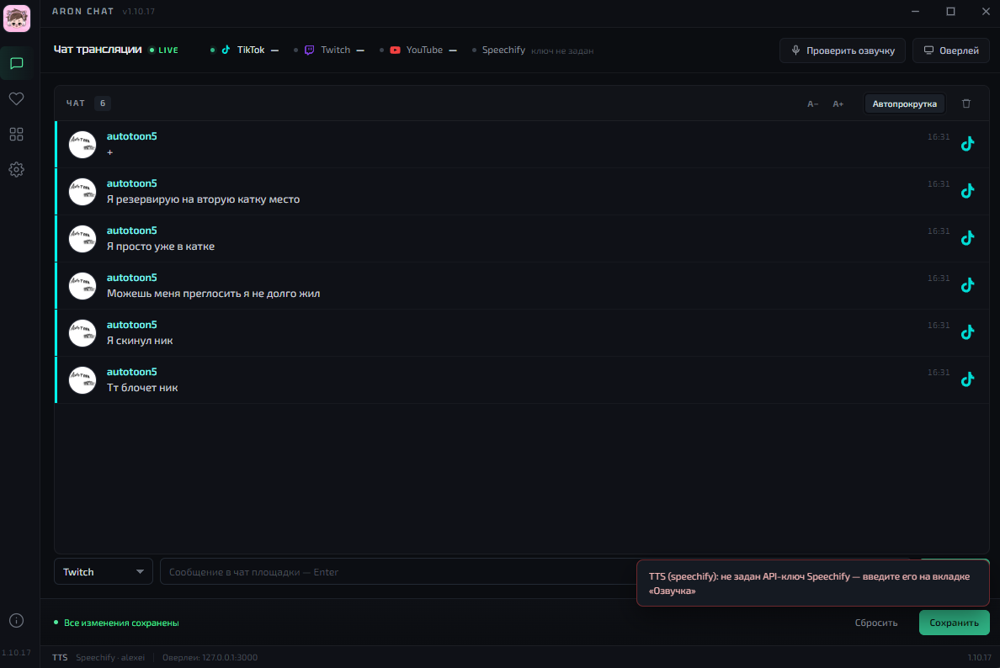
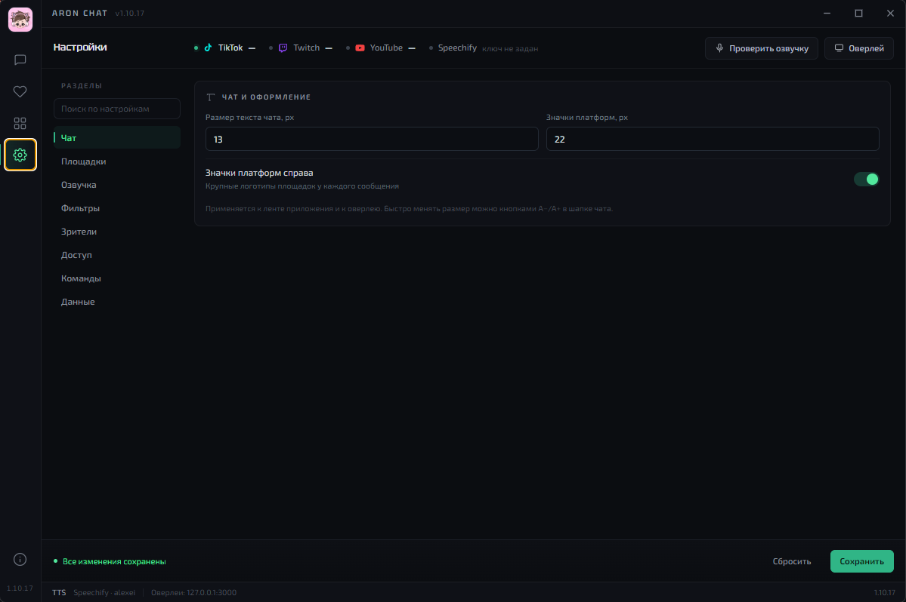
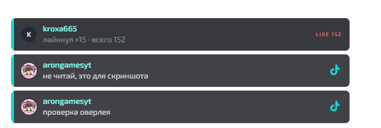

# Aron Chat

**Мультичат для стримеров: TikTok LIVE, Twitch и YouTube в одном окне, озвучка и оверлеи для OBS.**

Windows 10/11 · Electron · офлайн-озвучка Piper · без телеметрии

> Текущая версия: **1.10.31** · статус: активная разработка

---

## Возможности

- **Три площадки в одной ленте** — TikTok LIVE, Twitch, YouTube. Ники, цвета, аватары, эмоуты.
- **Озвучка сообщений** — облачная Speechify или офлайн Piper (русские голоса Дмитрий и Ирина). Очередь, скорость, громкость, «не читать ники».
- **Оверлеи для OBS** — чат и отдельный виджет зрителей. Прозрачный фон, свой CSS, фиксированный адрес `http://127.0.0.1:3000/overlay/chat` и `/overlay/viewers`.
- **Счётчики зрителей** — Twitch Helix, YouTube Data API, TikTok. В оверлее показываются только площадки, где реально идёт эфир.
- **Эмоуты и аватары** — 7TV, BTTV, FFZ, аватары Twitch/YouTube/TikTok.
- **Фильтры** — стоп-слова, игнорируемые пользователи, скрытие ботов, команды.
- **Блокировка в один клик** — наведи на сообщение и нажми «×»; сообщения пользователя исчезают сразу и больше не показываются.
- **Окно «События»** — лайки, подписки и подарки отдельно от чата. Лайки TikTok считаются по каждому зрителю.
- **Отправка сообщений** — Twitch и YouTube через OAuth (TikTok — только чтение).
- **Настройки** — вкладки, поиск по настройкам, размер текста чата, размер значков платформ, экспорт/импорт без секретов.
- **Приватность** — ключи и OAuth-токены шифруются на диске (Windows DPAPI), телеметрии нет.

## Скриншоты





## Установка

1. Скачайте `Aron Chat Setup <версия>.exe` из [Releases](../../releases).
2. Запустите установщик, примите условия и выберите папку.
3. Готово: ярлык появится на рабочем столе и в меню «Пуск».

Установка по умолчанию — в профиль пользователя, **без прав администратора**.
При установке в `C:\Program Files` потребуется UAC.

> Файл не подписан сертификатом, поэтому Windows SmartScreen может показать
> «Неизвестный издатель». Нажмите «Подробнее → Всё равно запустить».
> SHA-256 установщика публикуется вместе с релизом.

## Где лежат настройки

| Режим | Путь |
|---|---|
| Portable | `config.json` рядом с `.exe` |
| Установленная версия | `%APPDATA%\streamer-multichat\config.json` |
| Разработка | `config.json` в корне проекта |

`config.json` не коммитится: в нём ключи и токены. Секреты хранятся в зашифрованном виде.

## Сборка

```powershell
npm install
npm start                 # запуск в режиме разработки
npm run build:portable    # dist-new\Aron Chat <версия>.exe
npm run build:setup       # dist-setup\Aron Chat Setup <версия>.exe
npm run build:nsis        # запасной NSIS-установщик
```

### Встроенные OAuth-ключи

В репозитории **нет** `src/main/builtin.js` — файл с встроенными ключами
исключён из git. Для локальной сборки со «встроенным» входом создайте его
по шаблону `src/main/builtin.example.js`:

```js
module.exports = {
  googleClientId: '…apps.googleusercontent.com',
  googleClientSecret: 'GOCSPX-…',
  twitchClientId: '…',
};
```

Либо задайте переменные окружения `ARON_GOOGLE_CLIENT_ID`,
`ARON_GOOGLE_CLIENT_SECRET`, `ARON_TWITCH_CLIENT_ID`.
Без этого приложение работает, но OAuth-ключи нужно вводить вручную
в «Доступ → Продвинутые настройки».

### Голоса Piper

Голоса и `piper.exe` весят ~165 МБ и **не хранятся в репозитории**.
Перед сборкой положите их в `assets/piper/`:

```
assets/piper/
  piper.exe
  *.dll
  espeak-ng-data/
  voices/
    ru_RU-dmitri-medium.onnx
    ru_RU-dmitri-medium.onnx.json
    ru_RU-irina-medium.onnx
    ru_RU-irina-medium.onnx.json
```

Без них приложение соберётся, но офлайн-озвучка будет недоступна.

## Стек

- Electron 33, Node.js 20
- `tiktok-live-connector` (Euler Stream signing)
- `tmi.js` — Twitch IRC
- YouTube Data API v3
- Speechify API / Piper TTS
- electron-builder + собственный установщик на Electron

## Ограничения

- **TikTok** — неофициальный WebSocket. Возможны лимиты подписи и перебои; официального LIVE API нет. Отправка сообщений в TikTok не поддерживается.
- **YouTube** — нужен свой API-ключ и включённый YouTube Data API v3; квота 10 000 units/день.
- **Twitch** — для отправки нужен OAuth; для Confidential-приложения также Client Secret.
- Приложение не собирает статистику и не отправляет данные разработчику. При использовании Speechify текст сообщений уходит в Speechify API.

## Поддержать проект

Aron Chat бесплатный и без рекламы. Если приложение помогает в стримах,
можно поддержать разработку донатом:

**<https://www.donationalerts.com/r/arongames>**

## Лицензия

Проприетарная. Программа распространяется бесплатно, перепродажа установщика запрещена.
Используемые библиотеки и шрифты — по своим лицензиям (OFL и др.).

## Автор

**SGR (StreamRateGame)**
Сайт: <https://arongames.by/>
